# 求人比較ツール 使い方ガイド

対象バージョン: 0.4.3

このガイド内の会社名、求人、転職者条件、件数、パスは、すべて架空のサンプルです。
すべての画像は右上に`サンプル画面`と表示しています。

## 1. このガイドについて

### 追加機能：対象PDFコピー（右から2番目）

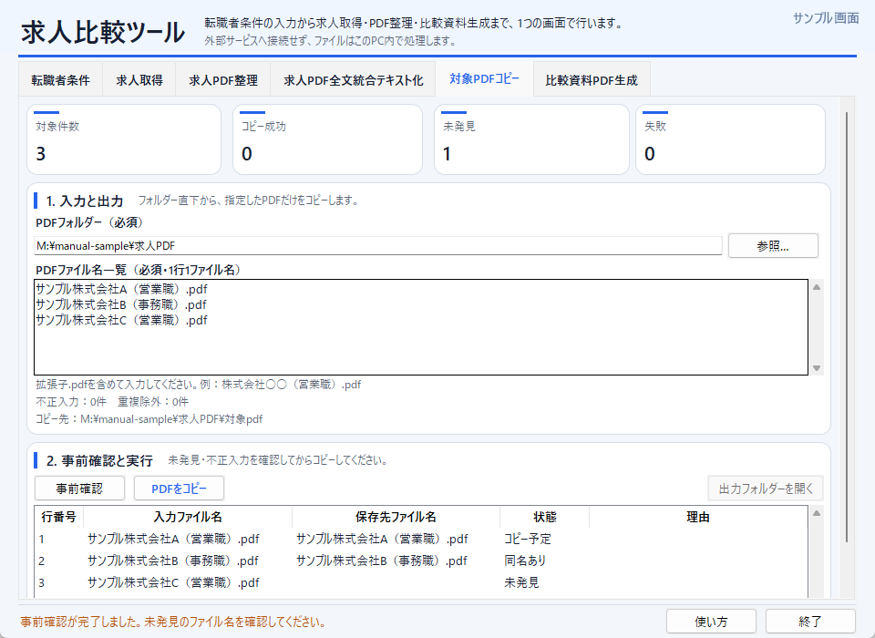

現在は6タブ構成です。「対象PDFコピー」が5番目、「比較資料PDF生成」が6番目になります。既存工程の画像は追加前の画面を含みます。

1. 「対象PDFコピー」タブを開き、「参照…」でPDFフォルダーを選択します。
2. PDFファイル名一覧へ、拡張子.pdfを含む名前を1行1件で貼り付けます。txtファイルの添付は不要です。
3. 「事前確認」で、完全一致するPDF、未発見、不正入力、重複を確認します。この段階ではファイルは作成されません。
4. 「PDFをコピー」を押します。同名PDFがあれば、1件ずつ置換・別名保存・キャンセルを選択します。
5. 最終確認で「コピー実行」を押すと、選択フォルダー直下の`対象pdf`へコピーします。別名保存は`名前 (1).pdf`形式です。
6. 結果一覧を確認し、「出力フォルダーを開く」から保存先を開けます。

入力例：

```text
株式会社サンプル（営業職）.pdf
株式会社テスト（事務職）.pdf
```

前後空白・HTML文字参照は自動整形します。部分一致やサブフォルダー検索は行いません。未発見が混在しても存在分はコピーします。競合判断中・最終確認でのキャンセルは書き込みを行いません。Ctrl+5でこのタブ、Ctrl+6で比較資料PDF生成、F5で現在のPDF系タブの事前確認を実行できます。

このガイドは、Windows向けGUI配布版を初めて使う人のための手順書です。配布版の利用にPythonは必要ありません。画面を確認しながら、ZIPの展開から6つのタブの操作まで進められます。

求人比較ツールは求人媒体、AI、外部サービスへ自動接続せず、選択したファイルをPC内で処理します。入力ファイルの選択や、生成したファイルの外部AIへの添付は利用者自身で行ってください。

画像はMarkdown対応ビューアーで表示できます。メモ帳などで開いた場合も本文は読めますが、画像は`images`フォルダー内のPNGを別に開いて確認してください。

## 2. 利用前の準備

### 初めて起動する方へ

このツールは未署名のため、Windowsが初回起動時に確認画面を表示する場合があります。

1. 自分が利用する予定のツールであり、信頼する配布元から受け取ったZIPであることを確認します。
2. 展開前のZIPを右クリックし、「プロパティ」→「全般」を開きます。
3. 下部に「許可する」が表示されていればチェックし、「適用」→「OK」を押します。表示されない場合は、この操作を省略して次へ進みます。
4. 配布ZIPを、書き込み可能な通常フォルダーへすべて展開します。
5. **JobComparisonTool.exe**をダブルクリックして起動します。既存の「求人比較ツールを起動.bat」も利用できます。

ブロック解除は安全性やウイルス検査済みであることを保証する操作ではありません。「許可する」がない場合も安全判定済みとは限りません。解除後も警告が残る場合があります。

| 状況 | 操作 |
|---|---|
| ZIPをすでに展開した | 元のZIPで上記の解除操作を行い、新しい別フォルダーへすべて展開し直します。既存フォルダーは削除・上書きせず、保存データを残します。 |
| 「Windows によって PC が保護されました」という青い警告が残る | 「詳細情報」でアプリ名が`JobComparisonTool.exe`であることを確認し、信頼する配布物であれば「実行」を選びます。 |
| 「実行」が表示されない | 会社・組織のPCでは管理者へ確認します。それ以外のPCでは表示内容を配布担当者へ伝えます。 |
| 別の検出・ブロック画面が出る | この手順の対象外です。表示内容を配布担当者へ伝えます。 |

### 作業前の準備

1. `JobComparisonTool.exe`、`_internal`、起動用BATを個別に移動しないでください。
2. 比較資料PDF生成を使う場合は、Microsoft EdgeまたはGoogle Chromeを用意します。
3. 使用するHTML、PDF、Markdown、JSONを作業別のフォルダーへ整理します。
4. 入力ファイルがクラウド同期中、編集中、または別アプリで更新中でないことを確認します。

> **重要:** ZIP内から直接起動しないでください。`_internal`を削除したり、実行ファイルだけを別の場所へ移動したりすると起動できません。

> **注意:** 同じ求人取得機能を独立版と同時に起動しないでください。また、処理中は入力ファイルを変更しないでください。

## 3. 全体ワークフロー

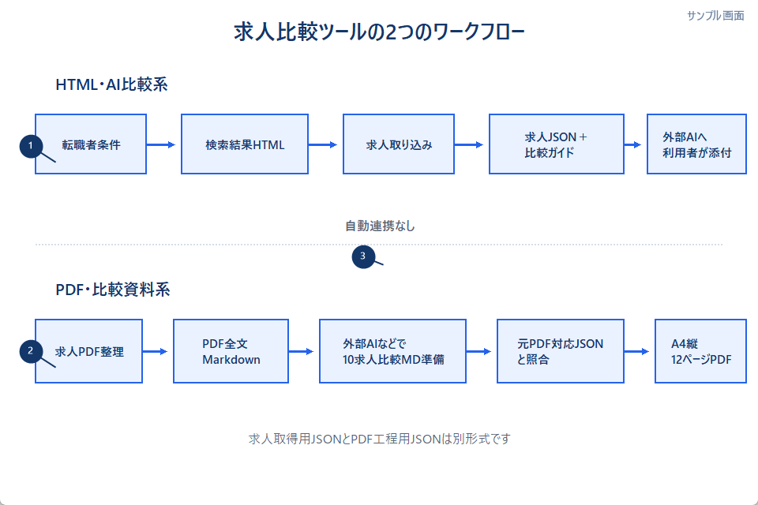

| 番号 | 説明 |
|---|---|
| ① | HTML・AI比較系は、保存済み検索結果HTMLから求人JSONと比較ガイドを作ります。 |
| ② | PDF・比較資料系は、求人PDFから全文Markdownを作り、別途用意した10求人比較Markdownと元PDF対応JSONから比較資料PDFを作ります。 |
| ③ | 2つの系統は自動連携しません。必要なファイルは利用者が選択・添付します。 |

HTML・AI比較ワークフローは次の流れです。

```text
転職者条件
  ↓
保存済みJoBins／CareerBank検索結果HTML
  ↓
求人取り込み
  ↓
求人JSON＋比較ガイド
  ↓
利用者が外部AIへ添付
```

PDF・比較資料ワークフローは次の流れです。

```text
求人PDF整理
  ↓
PDF全文Markdown
  ↓
外部AIなどで専用10求人比較Markdownを準備
  ↓
準備済み元PDF対応JSONと照合
  ↓
A4縦12ページの比較資料PDF
```

> **重要:** 求人取得用JSONとPDF工程用JSONは別形式です。転職者条件はPDF工程へ渡りません。PDF全文Markdownから比較資料用Markdownへの自動変換も行いません。

- 求人取得のAI比較は、上位最大20件を対象にします。
- 比較資料PDFの入力は、順位1～10がそろった厳密な10求人です。
- 元PDF対応JSONは、GUIでは作成・更新しません。

## 4. 起動・終了と共通画面

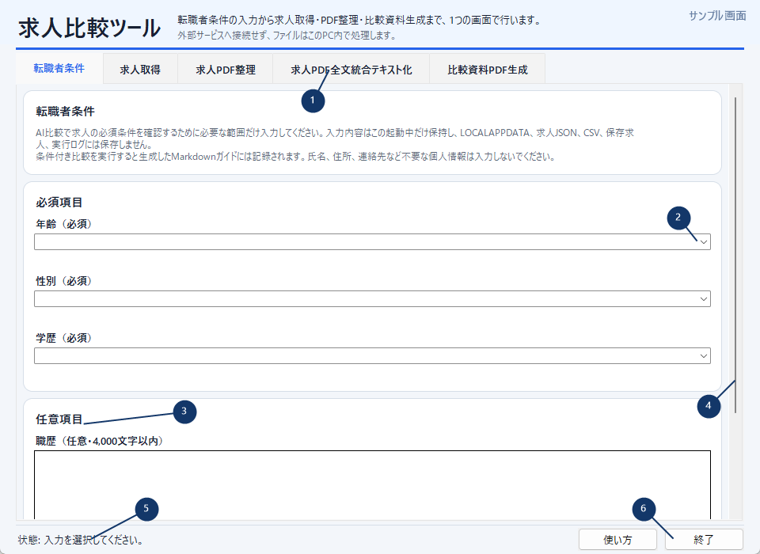

| 番号 | 説明 |
|---|---|
| ① | 6つの機能を切り替えるトップタブです。起動時は**転職者条件**が選ばれます。 |
| ② | 年齢・性別・学歴は必須項目です。 |
| ③ | 職歴・資格は任意項目です。下へスクロールして入力します。 |
| ④ | 転職者条件タブ全体のスクロールバーです。 |
| ⑤ | 処理状況や完了状態を表示します。 |
| ⑥ | **使い方**で画面内ヘルプを表示し、**終了**でアプリを閉じます。 |

求人取得機能は、転職者条件タブを表示したままバックグラウンドで準備されます。処理中は誤操作防止のため、タブや入力が一時的に無効になり、処理が終わるまで終了できません。

トップタブは、**転職者条件**、**求人取得**、**求人PDF整理**、**求人PDF全文統合テキスト化**、**比較資料PDF生成**の順です。

「警告付き完了」は異常終了ではありません。成果物は作成されていますが、警告内容を確認してから使用してください。

## 5. 転職者条件を入力する

1. **年齢（必須）**を選びます。
2. **性別（必須）**を選びます。
3. **学歴（必須）**を選びます。
4. 必要なら**職歴**を入力します。
5. 必要なら**資格**を入力します。
6. 保存操作は行わず、そのまま**求人取得**タブへ移動します。

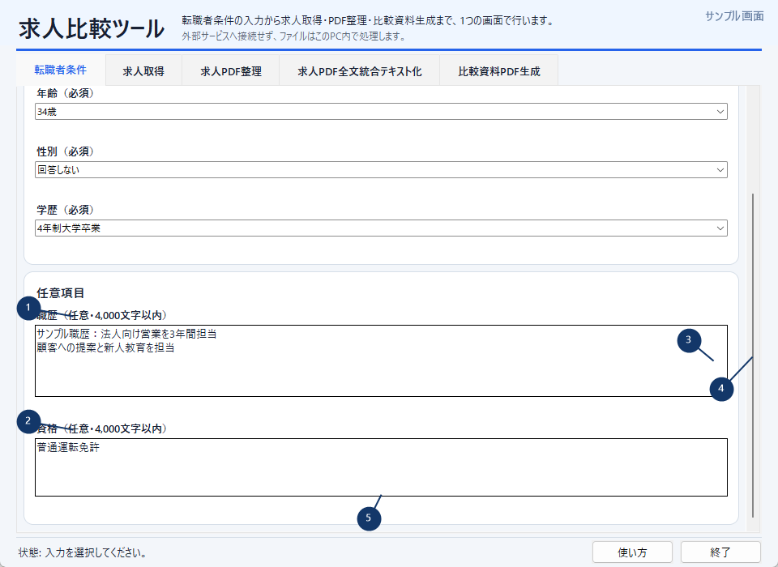

| 番号 | 説明 |
|---|---|
| ① | 職歴は任意で、4,000文字以内です。 |
| ② | 資格は任意で、初期値は`普通運転免許`です。 |
| ③ | ポインターが職歴・資格欄の上にある場合、その入力欄をスクロールします。 |
| ④ | カード、説明文、ラベル、エラー表示、余白の上では画面全体をスクロールします。 |
| ⑤ | 保存・確定ボタンはありません。AI比較ファイル作成時の値を使用します。 |

入力値はアプリを開いている間だけ保持され、終了すると消えます。`%LOCALAPPDATA%`、保存求人、CSV、求人JSON、ログ、PDF工程には保存されません。条件付き比較に成功した場合だけ、条件入りv9ガイドへ記録されます。

> **重要:** 氏名、住所、電話番号、メールアドレスなど、判定に不要な個人情報は入力しないでください。

Combobox上では外側画面をスクロールしません。職歴・資格欄が末尾に達しても、外側画面へ自動的にスクロールを引き継ぎません。ポインターを余白へ移動すると外側をスクロールできます。

必須項目が不足している場合は、不足したすべての項目にエラーが表示され、先頭のエラーへフォーカスします。職歴・資格が4,001文字以上の場合や、入力できない制御文字がある場合は、表示された欄を修正してください。

## 6. 求人取得を初期設定する

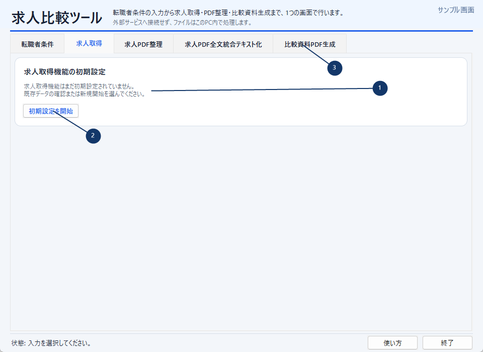

| 番号 | 説明 |
|---|---|
| ① | 求人取得機能の状態と初期設定が必要な理由を表示します。 |
| ② | **初期設定を開始**から、既存データ、移行、新規開始を選びます。 |
| ③ | 求人取得が未初期化でも、PDF関連の3機能は利用できます。 |

1. **求人取得**タブを選びます。
2. **初期設定を開始**を押します。
3. 表示された状態に合わせて次を選びます。

| 状態 | 選択 |
|---|---|
| 現在の保存先に正常な既存データがある | **既存データを使用** |
| 旧版フォルダーから移行したい | フォルダーを選び、**移行して使用** |
| データがない | **新規に開始** |
| 操作を中止する | **キャンセル** |

旧版移行はコピーであり、移行元を変更・削除しません。求人取得を初期設定しなくても、PDF関連の3タブは利用できます。

独立版の求人整理ツールが起動中の場合、求人取得だけが利用不可になります。独立版を終了してから**再試行**してください。

## 7. 求人検索結果HTMLを保存する

外部求人サイトの画面は、このガイドには掲載していません。

1. ブラウザでJoBinsまたはCareerBankを開きます。
2. 取り込みたい検索結果一覧を表示します。
3. ページの読み込みが完了していることを確認します。
4. ブラウザのページ保存機能で`.html`または`.htm`として保存します。
5. 保存先を求人比較用の作業フォルダーにします。例: `M:\manual-sample\求人HTML`

求人詳細ページ、PDF、MHTML／MHT、スクリーンショット、別媒体のHTMLは対象外です。読み込み途中やログイン切れのページも使用しないでください。

## 8. 求人を取り込む

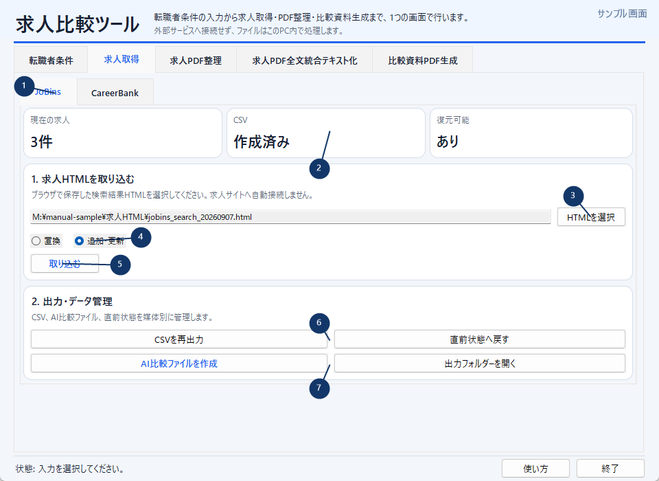

| 番号 | 説明 |
|---|---|
| ① | JoBins／CareerBankを切り替えます。 |
| ② | 現在求人、CSV、復元可能状態を確認します。 |
| ③ | **HTMLを選択**で保存済み検索結果HTMLを選びます。 |
| ④ | **置換**または**追加・更新**を選びます。 |
| ⑤ | **取り込む**で選択した方法の取り込みを開始します。 |
| ⑥ | CSV再出力と1世代の復元を行います。 |
| ⑦ | AI比較ファイルの作成と出力フォルダー表示を行います。 |

1. JoBinsまたはCareerBankを選びます。
2. **HTMLを選択**を押し、保存したHTMLを選びます。
3. **置換**または**追加・更新**を選びます。
4. **取り込む**を押します。
5. 完了件数とCSV更新結果を確認します。

| モード | 同一求人ID | 新規求人ID | HTMLにない既存求人 |
|---|---|---|---|
| 置換 | 今回内容で更新 | 追加 | 削除 |
| 追加・更新 | 今回内容で更新 | 追加 | 保持 |

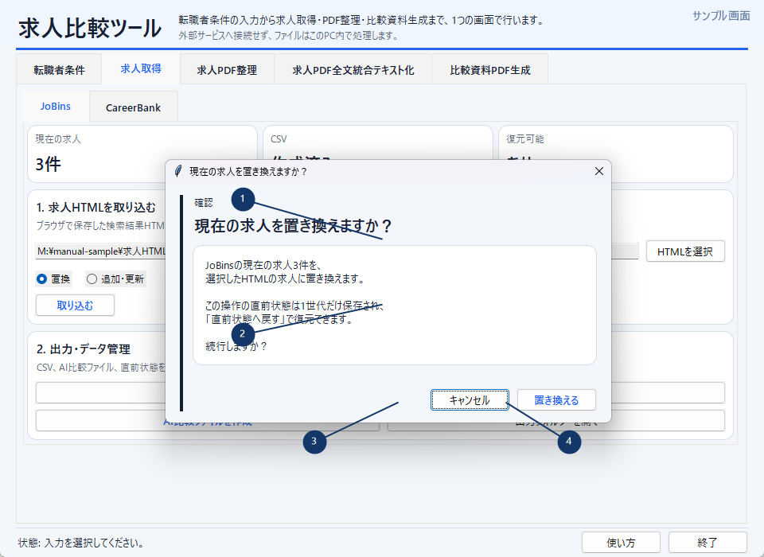

| 番号 | 説明 |
|---|---|
| ① | 置換対象の媒体と現在件数を確認します。 |
| ② | 直前状態は1世代だけ復元できることを確認します。 |
| ③ | **キャンセル**、×、Escapeでは変更しません。 |
| ④ | **置き換える**で続行します。 |

選択したモードはJoBins／CareerBankごとにアプリ終了まで保持されます。正常完了後は使用済みHTMLの選択だけが解除され、次のHTMLを選ぶと同じモードで続けられます。次回起動時は**置換**から始まります。

媒体ごとの上限は100件です。追加・更新後に100件を超える場合は保存しません。100件超過状態、出力先設定エラー、利用不可状態では、安全のため**置換**へ補正されます。

初回または置換では、HTML保存場所の`output`を媒体出力先として登録します。追加・更新では登録済み出力先を維持するため、別フォルダーのHTMLを選んでも出力先は勝手に切り替わりません。

## 9. 求人データを管理する

**CSVを再出力**は、求人が保存済みで出力先が正常な場合に使えます。CSVだけ失敗した場合の再作成にも使用できます。

- JoBins: `jobins_jobs.csv`
- CareerBank: `careerbank_jobs.csv`

**直前状態へ戻す**は、直前の取り込み前状態を1世代だけ復元します。繰り返しても2世代以上前には戻れません。確認ダイアログで内容を確認してから実行してください。

**出力フォルダーを開く**は、媒体に登録済みの出力先を開きます。出力先が未設定、破損、利用不可の場合は押せません。

## 10. AI比較ファイルを作る

1. 求人が取り込まれている媒体を選びます。
2. **AI比較ファイルを作成**を押します。
3. 転職者条件の状態に応じた確認を行います。
4. 完了ダイアログでファイル名を確認します。
5. **出力フォルダーを開く**で生成物を確認します。
6. 利用者自身が外部AIへ添付します。

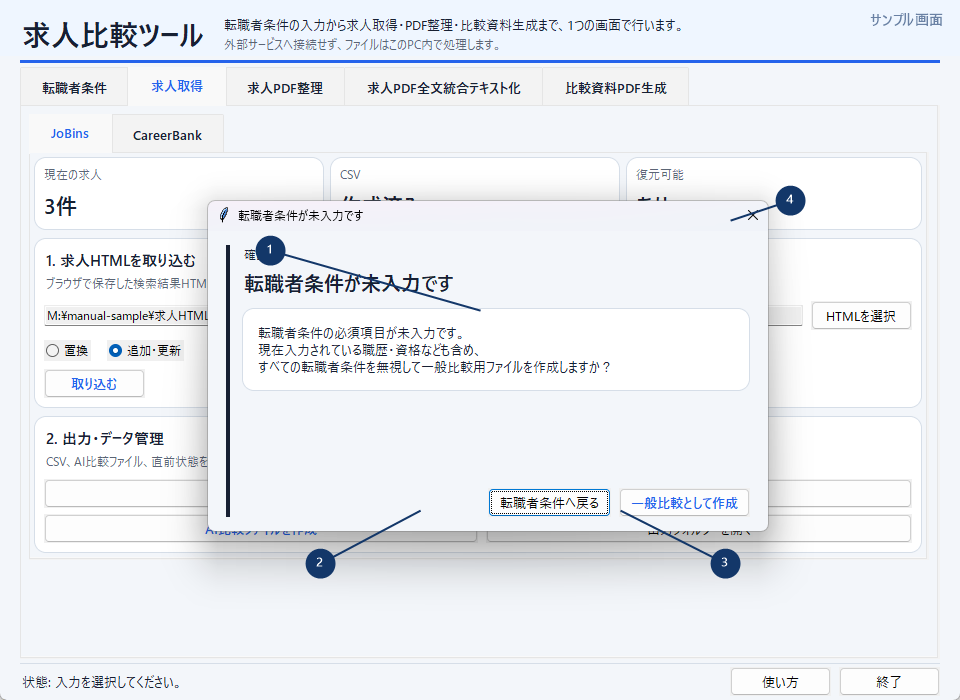

| 番号 | 説明 |
|---|---|
| ① | 入力済みの職歴・資格も含め、すべての転職者条件を無視することを確認します。 |
| ② | **転職者条件へ戻る**は生成せず、不足項目の修正へ戻ります。 |
| ③ | **一般比較として作成**は、条件を使わないv8一般比較を作ります。 |
| ④ | ×またはEscapeも、転職者条件へ戻る扱いです。 |

一般比較では求人JSONが必須で、v8ガイドは任意です。JSON単体でも利用できます。現在フォームに入力されている条件は、求人JSONにもガイドにも含めません。

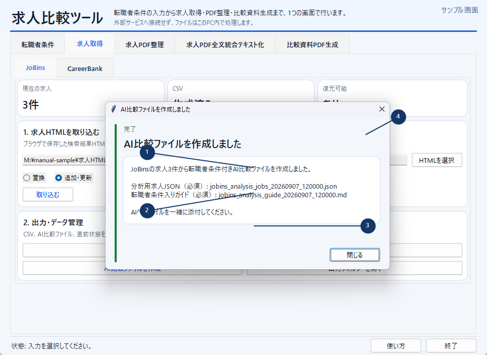

| 番号 | 説明 |
|---|---|
| ① | 求人JSONは必須です。 |
| ② | 条件入りv9ガイドも必須です。 |
| ③ | 条件付き比較では2ファイルを同時に外部AIへ添付します。 |
| ④ | 完了画面には転職者条件の実値を表示しません。 |

条件付き比較の生成例は次のとおりです。同一秒に既存ファイルがある場合は`_01`などの共通連番が付きます。

```text
jobins_analysis_jobs_20260907_120000.json
jobins_analysis_guide_20260907_120000.md
```

CareerBankでは先頭が`careerbank`になります。求人JSONへ転職者条件は入らず、転職者条件はv9ガイドだけに含まれます。

## 11. 求人PDFを整理する

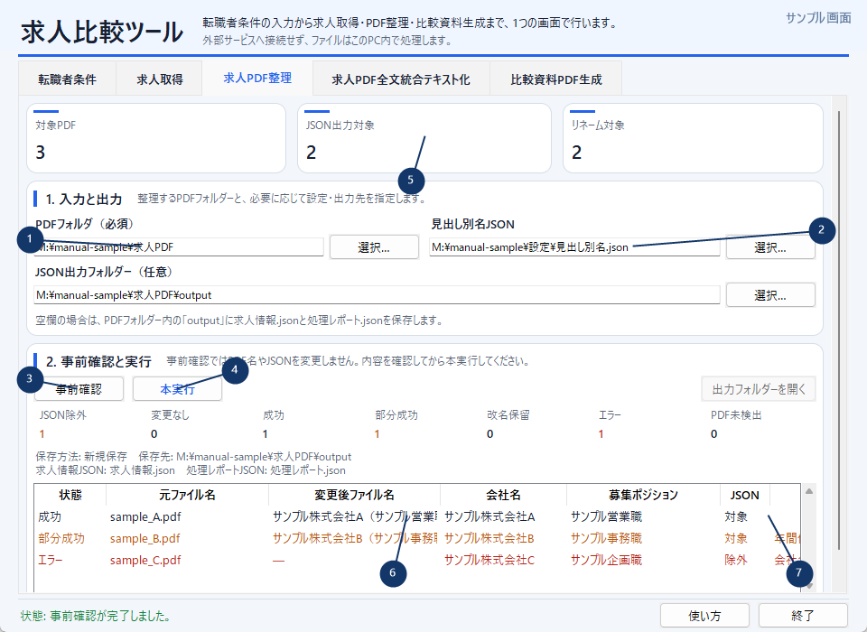

| 番号 | 説明 |
|---|---|
| ① | **PDFフォルダ（必須）**を選びます。 |
| ② | 必要なら見出し別名JSONとJSON出力フォルダーを指定します。 |
| ③ | **事前確認**ではファイルを変更しません。 |
| ④ | **本実行**で改名とJSON出力を確定します。 |
| ⑤ | 対象、JSON出力、リネーム件数などを確認します。 |
| ⑥ | PDFごとの状態、元名、変更後名、会社名、職種を確認します。 |
| ⑦ | 警告・除外理由を確認してから本実行します。 |

1. **PDFフォルダ（必須）**を選びます。
2. 必要なら**見出し別名JSON**を選びます。
3. 必要なら**JSON出力フォルダー**を選びます。
4. **事前確認**を押します。
5. メトリクス、対象一覧、警告、除外理由、変更後名を確認します。
6. **本実行**を押します。
7. 本実行直前の再解析結果を確認し、最終確認で実行します。

既定出力は次の2ファイルです。

```text
<PDFフォルダー>\output\求人情報.json
<PDFフォルダー>\output\処理レポート.json
```

> **注意:** 事前確認ではPDF名、JSON、`output`フォルダーを変更・作成しません。

本実行ではPDF改名、求人情報JSON、処理レポートJSONをまとめて確定し、途中で失敗した場合は元へ戻します。既存JSONがある場合は、置換、共通連番付き別名保存、キャンセルから選びます。

基準JSONがなく、旧`求人情報.csv`がある場合だけ初回移行できます。旧CSVは変更・削除しません。

読取不能、暗号化、会社名未確定、求人名未確定のPDFは元の名前と場所に残ります。処理可能なPDFだけを警告付きで確定できる場合があるため、対象表の「警告・除外理由」を必ず確認してください。

## 12. PDF全文をMarkdownへまとめる

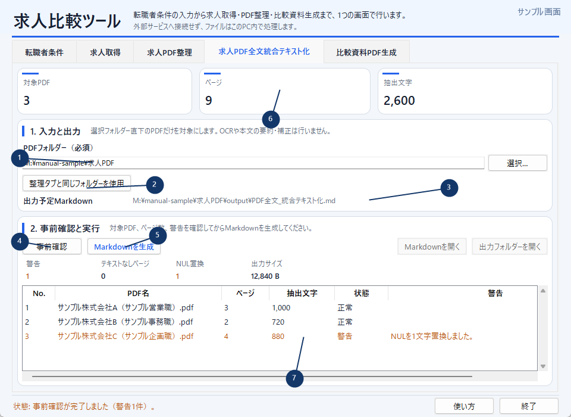

| 番号 | 説明 |
|---|---|
| ① | **PDFフォルダー（必須）**を選びます。 |
| ② | **整理タブと同じフォルダーを使用**は、その時点の値を1回コピーします。 |
| ③ | 出力予定Markdownを確認します。 |
| ④ | **事前確認**で件数、ページ数、文字数、警告を確認します。 |
| ⑤ | **Markdownを生成**で再抽出・再確認後に確定します。 |
| ⑥ | 全体の件数、ページ、抽出文字を確認します。 |
| ⑦ | PDFごとの抽出結果と警告を確認します。 |

1. **PDFフォルダー（必須）**を選びます。
2. 必要なら**整理タブと同じフォルダーを使用**を押します。
3. 出力予定Markdownを確認します。
4. **事前確認**を押します。
5. PDF件数、ページ数、抽出文字、警告を確認します。
6. **Markdownを生成**を押し、再抽出後の確認で確定します。
7. 完了後にMarkdownまたは出力フォルダーを開きます。

出力は次のファイルです。

```text
<PDFフォルダー>\output\PDF全文_統合テキスト化.md
```

選択フォルダー直下のPDFだけが対象で、サブフォルダーは対象外です。整理タブからフォルダーをコピーした後は自動追従しません。OCR、要約、本文補正は行わず、NULは可視文字へ置換します。PDF境界と元ファイル名はMarkdownへ記録されます。

空ページ、NUL置換、150,000文字以上、500,000バイト以上は警告付き成功です。一方、読取不能PDF、パスワード必須PDF、ページがないPDFが1件でもある場合はMarkdown全体を生成しません。PDF整理の部分成功とは動作が異なります。

## 13. 外部AIで比較Markdownを準備する

`PDF全文_統合テキスト化.md`は、比較資料PDFタブへ直接渡せる形式ではありません。利用者が外部AIなどへ次の情報を渡し、比較資料PDF用Markdownを準備してください。

- `PDF全文_統合テキスト化.md`
- 必要に応じて`求人情報.json`
- 比較条件と、比較資料用の出力形式指示

比較資料用Markdownには、次の条件が必要です。

- 求人順位が1～10の連番で、比較一覧が10行ある。
- 各求人に会社名、募集ポジション、必須ヘッダ表、必須セクションがある。
- 第一優先5件、第二優先2件、条件付き3件に分かれている。
- 比較一覧と詳細の会社名・順位が一致する。

次は構造説明用の1求人分だけの抜粋であり、実行可能な完全サンプルではありません。

```markdown
# 求人比較資料

## 比較一覧

| 順位 | 会社名 | 募集ポジション |
|---:|---|---|
| 1 | サンプル株式会社A | サンプル営業職 |
| … | … | … |

## 1位 サンプル株式会社A

### サンプル営業職

| 項目 | 内容 |
|---|---|
| 雇用形態 | 正社員 |
| 評価 | A |
| 年収 | 記載なし |
| … | … |

#### 業務概要

- サンプルの業務説明

#### おすすめポイント

- サンプルの判断理由

#### メリット

- サンプル

#### デメリット

- サンプル

#### 総合判断

- サンプル
```

詳細な必須ヘッダ・セクションは[比較資料PDF生成の技術仕様](../../README_job_comparison_report.md)を確認してください。

## 14. 元PDF対応JSONを準備する

元PDF対応JSONはGUIでは作成・更新できません。順位1～10の求人と元PDFを固定対応させ、内容のSHA-256を記録したJSONを事前に準備します。

次は1求人分だけの構造例です。実際は順位1～10が必要です。

```json
{
  "jobs": [
    {
      "rank": 1,
      "company": "サンプル株式会社A",
      "position": "サンプル営業職",
      "source_pdf": "<元PDFの絶対パス>",
      "sha256": "<SHA-256>"
    }
  ]
}
```

- 比較Markdownと会社名、募集ポジション、順位を一致させます。
- 元PDFの内容が変わるとSHA-256不一致になります。
- 類似PDFへ自動で切り替えません。
- GUIは元PDF対応JSONを更新しません。
- 正式にPDFを差し替えた場合だけ、内容確認後に設定を更新します。

詳細は[元PDF対応設定の仕様](../../README_job_comparison_report.md#元pdf対応設定)を確認してください。

## 15. 比較資料PDFを生成する

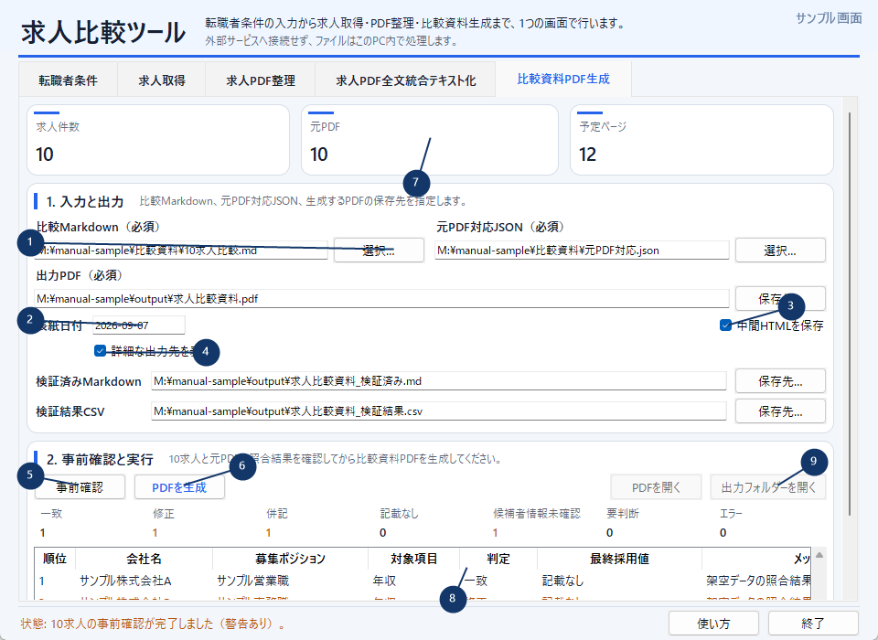

| 番号 | 説明 |
|---|---|
| ① | 比較Markdown、元PDF対応JSON、出力PDFの3つは必須です。 |
| ② | 表紙日付は必要な場合だけ`YYYY-MM-DD`で入力します。 |
| ③ | 必要な場合だけ中間HTMLを保存します。 |
| ④ | 詳細な出力先を展開して検証済みMDと検証結果CSVを確認します。 |
| ⑤ | **事前確認**で10求人と照合結果を確認します。 |
| ⑥ | **PDFを生成**で再照合後に生成します。 |
| ⑦ | 一致、警告、要判断、エラーの件数を確認します。 |
| ⑧ | 求人・項目ごとの判定と採用値を確認します。 |
| ⑨ | 完了後にPDFまたは出力フォルダーを開きます。 |

1. **比較Markdown（必須）**を選びます。
2. **元PDF対応JSON（必須）**を選びます。
3. **出力PDF（必須）**を指定します。
4. 必要なら表紙日付を`YYYY-MM-DD`で入力します。
5. 必要なら**中間HTMLを保存**を選びます。
6. 必要なら**詳細な出力先を表示**を開きます。
7. **事前確認**を押し、照合結果を確認します。
8. **PDFを生成**を押します。
9. 再照合とブラウザ生成後の成果物を確認します。

| 判定 | PDF生成 |
|---|---|
| 一致 | 可能 |
| 修正 | 警告付きで可能 |
| 併記 | 警告付きで可能 |
| 記載なし | 警告付きで可能 |
| 候補者情報未確認 | 警告付きで可能 |
| 要判断 | 不可 |
| エラー | 不可 |

出力は次のとおりです。

```text
<指定した出力PDF>
<出力PDFのstem>_検証済み.md
<出力PDFのstem>_検証結果.csv
<任意の中間HTML>
```

完成PDFはA4縦12ページです。比較一覧1ページ、求人詳細10ページ、応募優先順位1ページで構成されます。

## 16. 出力ファイル早見表

| 機能 | 主な出力 | 既定場所 |
|---|---|---|
| 求人取得 | `jobins_jobs.csv`／`careerbank_jobs.csv` | 登録済み媒体出力先 |
| 条件付きAI比較 | 求人JSON＋v9ガイド | 媒体出力先 |
| 一般AI比較 | 求人JSON＋任意v8ガイド | 媒体出力先 |
| 求人PDF整理 | `求人情報.json`、`処理レポート.json` | `<PDFフォルダー>\output` |
| PDF全文統合 | `PDF全文_統合テキスト化.md` | `<PDFフォルダー>\output` |
| 比較資料PDF | PDF、検証済みMD、検証結果CSV | 利用者指定先 |

## 17. ショートカット

| キー | 動作 | 有効範囲 |
|---|---|---|
| `Ctrl+1` | 転職者条件 | 共通 |
| `Ctrl+2` | 求人取得 | 共通 |
| `Ctrl+3` | 求人PDF整理 | 共通 |
| `Ctrl+4` | PDF全文統合 | 共通 |
| `Ctrl+5` | 対象PDFコピー | 共通 |
| `Ctrl+6` | 比較資料PDF生成 | 共通 |
| `F1` | 使い方 | 共通 |
| `F5` | 事前確認 | PDF系3タブ |
| `Alt+J` | JoBins | 求人取得タブ |
| `Alt+C` | CareerBank | 求人取得タブ |
| `Ctrl+O` | HTML選択 | 求人取得タブ |
| `Ctrl+I` | 取り込み | 求人取得タブ |
| `Ctrl+E` | CSV再出力 | 求人取得タブ |
| `Ctrl+R` | 直前状態へ復元 | 求人取得タブ |
| `Ctrl+G` | AI比較ファイル生成 | 求人取得タブ |
| `Ctrl+Shift+O` | 出力フォルダーを開く | 求人取得タブ |

処理中および共通ダイアログ表示中は、誤操作防止のためショートカットが遮断されます。

## 18. ボタンが押せない場合

| ボタン | 主な無効理由 |
|---|---|
| 取り込む | HTML未選択、処理中、媒体利用不可 |
| 追加・更新 | 100件超過状態、出力先エラー、処理中 |
| CSV再出力 | 求人0件、出力先未設定・エラー、処理中 |
| 直前状態へ戻す | 前世代なし、出力先異常、処理中 |
| AI比較ファイルを作成 | 求人0件、出力先異常、処理中 |
| PDF系の事前確認 | 必須入力不足、パス不正、処理中 |
| 本実行／生成 | 事前確認未完了、入力変更、要判断、エラー |

入力・出力欄と画面下部の状態表示を確認し、処理中の場合は完了を待ってください。

## 19. エラーと復旧

| コード | 対処 |
|---|---|
| `CHANGED001` | 入力や出力が確認後に変わったため、再度事前確認します。 |
| `INPUT001` | パス、必須入力、ファイル形式を確認します。 |
| `BROWSER001` | EdgeまたはChromeの存在と起動可否を確認します。 |
| `OUTPUT001` | 保存先、書込権限、使用中ファイルを確認します。 |
| `LOCK001` | 同じ処理や同じアプリが実行中でないか確認します。 |
| `APP003` | 独立版求人整理ツールを終了して再試行します。 |
| `IMPORT_FORMAT_UNSUPPORTED` | 媒体と、保存した検索結果HTMLを確認します。 |
| `IMPORT_VALIDATION_FAILED` | HTMLが検索結果ページであるか確認します。 |
| `CSV001` | 求人保存済みなら**CSVを再出力**を試します。 |

> **重要:** ロックファイルは、同じ処理が動いていないことを確認できた場合だけ削除してください。実行中に削除すると同じ出力が競合するおそれがあります。

## 20. 個人情報とデータ保存

- 転職者条件は、正常生成した条件付きv9ガイド以外へ保存しません。
- 求人JSONには転職者条件を含めません。
- 求人媒体やAIへ自動送信しません。
- 外部AIへの添付前に、求人と転職者条件の内容を確認してください。
- 実求人や候補者情報を手順書・スクリーンショットへ転用しないでください。
- 求人取得の保存データとPDF工程のデータは別に管理します。
- バックアップは利用者自身が出力フォルダー単位で行ってください。

このガイドの画面と例は、すべて架空のサンプルです。
